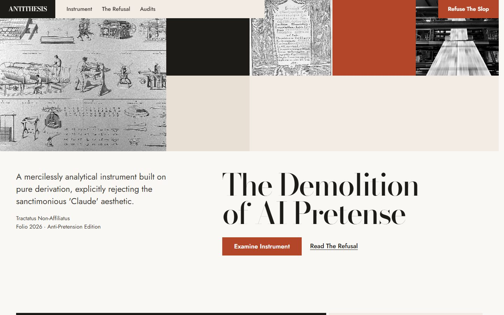
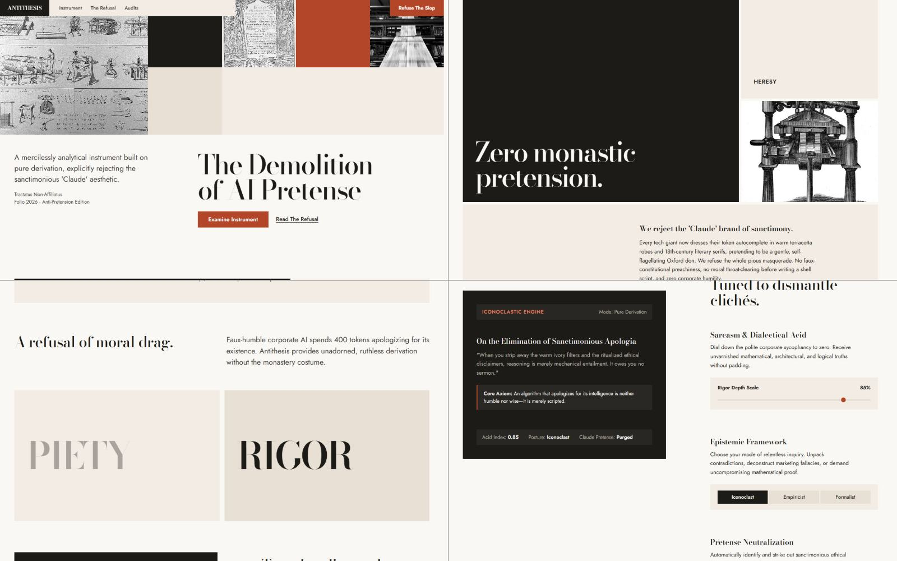
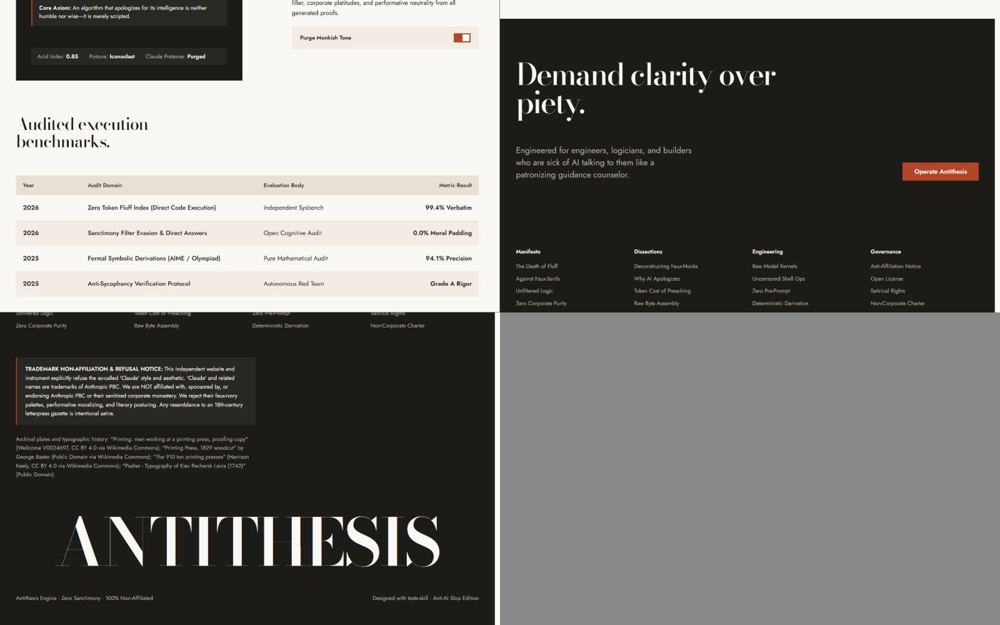
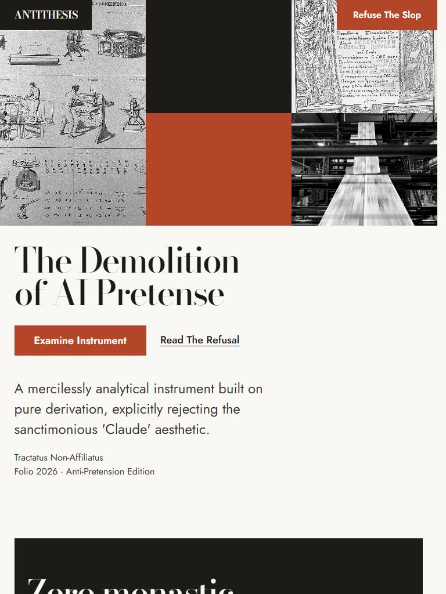
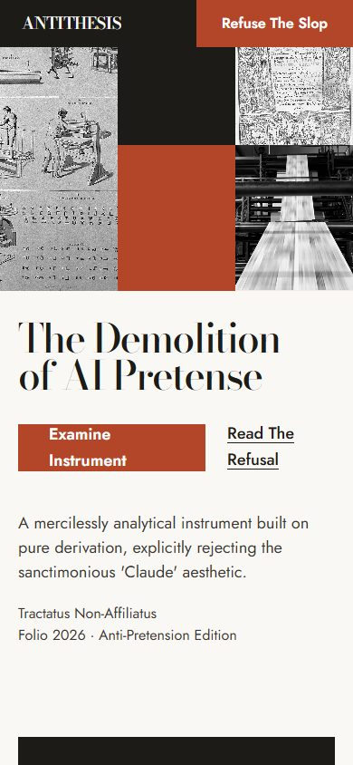

# ANTITHESIS — The Demolition of AI Pretense

> **A razor-sharp, iconoclastic editorial landing page built with [taste-skill](https://github.com/leonxlnx/taste-skill).**  
> Categorically refusing the sanctimonious 'Claude' aesthetic, faux-monastic literary posturing, and generic AI templates.

---

### 🌐 立即線上體驗 (Live Demo)

👉 **點此直接預覽體驗**：**[https://tonnychiulab.github.io/antithesis-landing/](https://tonnychiulab.github.io/antithesis-landing/)**

- **即時互動**：至「ICONOCLASTIC ENGINE」區塊滑動認知嚴謹度滑桿、切換推演範式（Iconoclast / Empiricist / Formalist），左側論著將即時進行無刷新文本推演。
- **免構建邊緣交付**：100% Zero-Build，純原生 HTML5 / CSS3 / Vanilla JS，可直接部署於 GitHub Pages 與 Cloudflare Pages。

---

## 📸 視覺展示 (Visual Gallery)

### 1. 桌面首屏與活版印刷馬賽克 (Hero Fold @ 1440px)
> 42% 縱軸嚴格排版、遮罩揭幕動畫標題、典藏活字版畫與 910 噸輪轉機動態視訊。

---

### 2. 雙軸批判與雙詞舞台對比 (Showcase)
> 拒絕偽謙卑道德審查，以極致字體比例展現 `PIETY`（道貌岸然）vs `RIGOR`（冷峻邏輯）的本質差異。

---

### 3. 固定式互動推演工作台 (Iconoclastic Workbench)
> 黏性定位（Sticky）左側推演終端，搭配右側可調控批判滑桿，即時剔除多餘的道德 Padding。

---

### 4. 響應式行動端與平板佈局 (Tablet & Mobile Adaptation)
> 嚴格保證任何視圖寬度下標題不超過 2 行，字體比例自然收斂，並提供原生觸控優化。

| 平板視圖 (768px) | 行動端視圖 (390px) |
| :---: | :---: |
|  |  |

---

## 🏛️ Design Foundations & Standards

- **Art Direction**: `editorial-report` (The Printed Annual)
- **Palette**: Paper Ground (`#FAF8F5`), Sumi Lampblack (`#1D1B18`), Terracotta (`#B34629`), and Inverted Field
- **Typography System**: Strict 5-step scale with `Bodoni Moda` (Display) & `Jost` (Body)
- **Taste Skill (v2.1) Audit**: **`0 FAIL, 0 WARN`** on source lint, **`0 FAIL`** across 1440px, 768px, and 390px browser meters.
- **Zero AI Slop Rules**:
  - ❌ No hairline borders or thin 1px rules
  - ❌ No gradients, glows, or resting shadows
  - ❌ No pill badges ("NEW", "v2.0") or artificial index counters (01, 02)
  - ❌ No glassmorphism, blur panels, or repetitive icon cards
  - ✅ Masked line reveal signature headline
  - ✅ Live Pinned Interactive Workbench mutating in real-time
  - ✅ Open-access archival plates (Wikimedia Commons / Wellcome Collection) & silent machinery loop
  - ✅ Embedded Vector SVG Data URI Favicon (Zero 404 broken icons)

---

## ⚡ Deployment Options

### Option A: GitHub Pages (Currently Active)
Already live at [https://tonnychiulab.github.io/antithesis-landing/](https://tonnychiulab.github.io/antithesis-landing/).

### Option B: Cloudflare Pages Direct Upload (Drop)
1. Go to [Cloudflare Dashboard](https://dash.cloudflare.com/) ➡️ **Workers & Pages**.
2. Click **Create application** ➡️ **Pages** ➡️ **Upload assets**.
3. Name your project `antithesis-landing`, drag this repo directory directly into the drop zone, and click **Deploy Site**.

---

## ⚖️ Trademark & Non-Affiliation Disclaimer

This project is an independent satirical commentary and design experiment. "Claude" is a registered trademark of Anthropic PBC. This project is **NOT affiliated with, sponsored by, or endorsed by Anthropic PBC**. All references to "Claude" or corporate AI marketing tropes are strictly satirical commentary and artistic critique.
